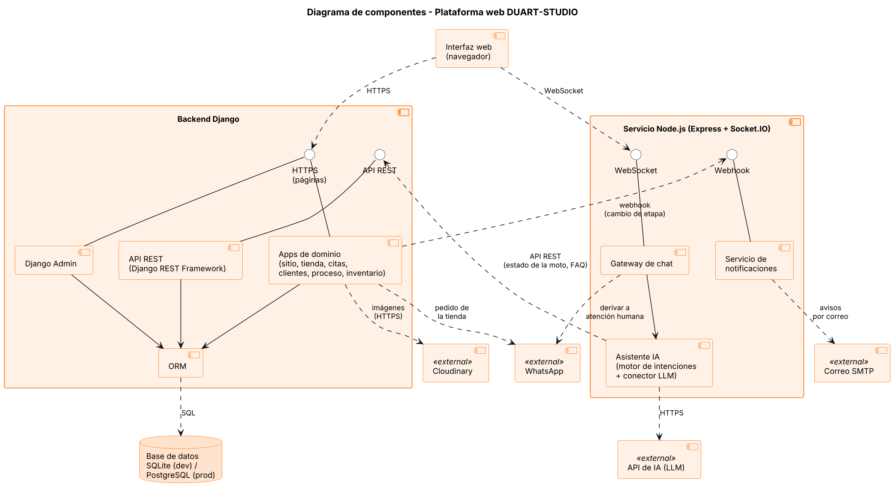

# DUART-STUDIO · Plataforma Web

Plataforma web para **DUART-STUDIO**, un taller de pintura y personalización de motocicletas en Tunjuelito, Bogotá. Reúne en un solo lugar el sitio público del taller, el seguimiento en línea del proceso de cada moto, el control de insumos y un asistente virtual con inteligencia artificial.

> Proyecto Integrador **ExpoUninpahu 2026** · Ingeniería de Software · Fundación Universitaria UNINPAHU
> Docente: Elfar Didier Morantes Sánchez

## Problema

- **Baja visibilidad digital:** el taller depende de redes sociales y del voz a voz; no tiene un medio propio con su portafolio, servicios y contacto.
- **Gestión manual:** el seguimiento de cada moto y de las pinturas e insumos se lleva en cuadernos, sin trazabilidad. Los clientes deben llamar para saber en qué etapa va su moto.

## Solución

| Módulo | Qué hace |
|---|---|
| Sitio público | Servicios y precios de referencia, galería de trabajos, noticias y solicitud de cita |
| Tienda por catálogo | Carrito de productos; el pedido se envía por WhatsApp |
| Cuenta de cliente | Registro con autorización de datos (Ley 1581 de 2012) |
| Mi Proceso | El cliente consulta la etapa de su moto: alistamiento, lijado, preparación de pintura, detallado y pulido |
| Panel administrativo | Django Admin para gestionar contenidos, citas, vehículos y etapas |
| Insumos | Plantilla de insumos por modelo y etapa, y solicitudes de materiales |
| Asistente virtual (IA) | Responde preguntas frecuentes, consulta el estado de la moto y deriva cotizaciones a WhatsApp |

## Arquitectura



| Componente | Tecnología | Rol |
|---|---|---|
| Backend | Django + Django REST Framework | Apps del taller, Django Admin, autenticación y API REST |
| Tiempo real | Node.js + Express + Socket.IO | Chat del asistente y notificaciones de cambio de etapa |
| IA | Motor de intenciones + API de LLM | Preguntas frecuentes primero; si no reconoce la pregunta, consulta el LLM |
| Base de datos | SQLite (desarrollo) / PostgreSQL en Neon (producción) | Solo Django escribe; Node.js lee por la API REST |
| Contenedores | Docker + Docker Compose | Levanta Django y Node.js con un solo comando |
| Despliegue | GitHub + Vercel | Cada push publica la plataforma con HTTPS |

Diagramas completos en [`docs/uml/`](docs/uml): casos de uso, componentes, despliegue y secuencia (inicio de sesión con roles y CRUD de vehículos).

## Estado del proyecto

| Entrega | Fecha | Alcance | Estado |
|---|---|---|---|
| Entrega 1 | 05/11/2026 | SRS, UML, backlog, matriz de trazabilidad y repositorio | ✅ Entregada |
| Entrega 2 | 12/11/2026 | CRUD, login, roles, Django Admin, Dockerfile y despliegue | 🚧 En curso (CRUD, login, roles, Admin y secuencia listos) |
| Entrega 3 | 19/11/2026 | Microservicio Node.js, Swagger, IA y Docker Compose | ⏳ Pendiente |
| ExpoUninpahu | 26/11/2026 | Producto final completo | ⏳ Pendiente |

**Prototipo actual (Django):** sitio con servicios (RF-01), galería de trabajos (RF-02), solicitud de cita (RF-07) y CRUD de servicios (RF-16).

### Entrega 2 · Qué se implementó

| Funcionalidad | Requisitos | Dónde |
|---|---|---|
| **CRUD principal: vehículos en taller** — crear, listar con filtros por etapa/cliente/placa, ver, editar y eliminar | RF-14 | `/panel/vehiculos/` |
| **Cambio de etapa** con fecha y responsable guardados en el historial | RF-13 | Detalle del vehículo y Django Admin |
| **Registro de cliente** con casilla obligatoria de autorización de datos (Ley 1581 de 2012), correo único y contraseña cifrada | RF-08 | `/cuenta/registro/` |
| **Login** con correo o usuario, mensaje de error genérico, cierre de sesión y **bloqueo de 15 min tras 5 intentos fallidos** (también en Django Admin) | RF-09, RF-15 | `/cuenta/ingresar/` |
| **Roles** Visitante, Cliente y Administrador (grupos de Django con permisos, creados automáticamente en cada `migrate`) | RF-15 | `taller_motos/roles.py` |
| **Mi Proceso**: el cliente registra su moto y ve las cinco etapas con la actual resaltada | RF-10, RF-11 | `/mi-proceso/` |
| **Citas** con estados pendiente, confirmada y cancelada | RF-17 | `/panel/citas/` y Django Admin |
| **Django Admin** personalizado: vehículos con historial en línea y acción "Avanzar etapa", citas editables en la lista, usuarios con su rol y perfil | RF-13, RF-14, RF-16, RF-17 | `/admin/` |
| **Diagramas de secuencia** (login y roles; CRUD de vehículos) | — | [login y roles](docs/uml/4_secuencia_login_roles.png) · [CRUD de vehículos](docs/uml/5_secuencia_crud_vehiculos.png) |

| Ruta | Visitante | Cliente | Administrador |
|---|:-:|:-:|:-:|
| Inicio, galería, servicios, agendar cita | ✅ | ✅ | ✅ |
| Mi Proceso / registrar mi moto | ➜ login | ✅ (solo sus motos) | — |
| Panel: vehículos, citas, servicios | ➜ login | ⛔ 403 | ✅ |
| Django Admin | ➜ login | ⛔ | ✅ |

## Estructura del repositorio

```
duart-studio/
├── backend-django/        Proyecto Django (config/ y app taller_motos/)
├── docs/
│   ├── SRS_DUART-STUDIO_Entrega1.docx        Documento SRS
│   ├── DUART-STUDIO_Backlog_y_Matriz.xlsx    Backlog y matriz de trazabilidad
│   └── uml/                                   Diagramas (PNG + código PlantUML)
├── scripts/
│   └── crear_backlog.sh   Crea las historias de usuario en GitHub Projects
├── .env.example           Variables de entorno de ejemplo
├── .gitignore
└── README.md
```

El servicio `servicio-node/`, los `Dockerfile` y el `docker-compose.yml` se agregan en las entregas 2 y 3.

## Cómo ejecutarlo en local

Requisitos: Python 3.12 o superior.

```bash
cd backend-django
python -m venv .venv
# Windows: .venv\Scripts\activate    ·    macOS/Linux: source .venv/bin/activate
pip install -r requirements.txt
python manage.py migrate
python manage.py cargar_datos_demo
python manage.py runserver
```

El repositorio incluye `backend-django/db.sqlite3` ya migrada y con datos de demostración, así que tras instalar dependencias basta con `python manage.py runserver`. `cargar_datos_demo` vuelve a crear los roles, usuarios y datos de ejemplo sin duplicar nada.

- Sitio: http://127.0.0.1:8000/
- Panel administrativo: http://127.0.0.1:8000/admin/

**Usuarios de demostración** (solo para desarrollo):

| Rol | Correo | Contraseña |
|---|---|---|
| Administrador | `admin@duartstudio.co` (usuario `admin`) | `DuartAdmin2026*` |
| Cliente | `cliente@duartstudio.co` | `Cliente2026*` |
| Cliente | `andres.rojas@correo.co` | `Cliente2026*` |

Para correr las pruebas: `python manage.py test`

## Variables de entorno

Copia `.env.example` como `.env` y completa los valores. El archivo `.env` nunca se sube al repositorio.

| Variable | Uso |
|---|---|
| `DJANGO_SECRET_KEY` | Clave secreta de Django |
| `DJANGO_DEBUG` | `True` en desarrollo, `False` en producción |
| `DJANGO_ALLOWED_HOSTS` | Dominios permitidos, separados por coma |

## Backlog

El backlog se gestiona en **GitHub Projects**, con una tarjeta por historia de usuario (HU-01 a HU-22) etiquetada por entrega y prioridad. La versión completa con criterios de aceptación y la matriz de trazabilidad está en [`docs/`](docs).

## Equipo

| Integrante | Rol en el proyecto |
|---|---|
| Nasly Trujillo ([@N4SL7](https://github.com/N4SL7)) | Arquitectura y desarrollo |
| Kevin Reyes | Análisis del problema y requisitos |

## Uso de inteligencia artificial

En la documentación de este proyecto se utilizó el asistente Claude (Anthropic) como apoyo para organizar el contenido, generar el código PlantUML de los diagramas y revisar la coherencia de los requisitos. Todo el contenido fue revisado y validado por el equipo.
