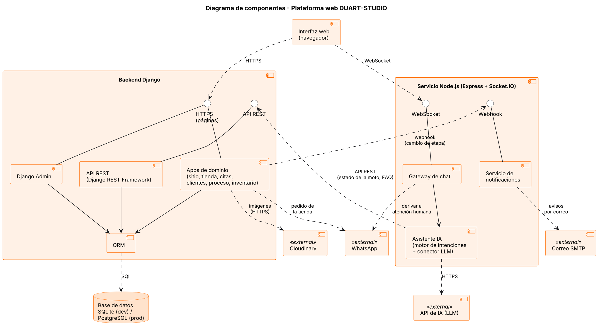

# DUART-STUDIO · Plataforma Web

Plataforma web para **DUART-STUDIO**, un taller de pintura y personalización de motocicletas en Tunjuelito, Bogotá. Reúne en un solo lugar el sitio público del taller, el seguimiento en línea del proceso de cada moto, el control de insumos y un asistente virtual con inteligencia artificial.

> Proyecto Integrador **ExpoUninpahu 2026** · Ingeniería de Software · Fundación Universitaria UNINPAHU
> Docente: Elfar Didier Morantes Sánchez

🌐 **Aplicación publicada:** https://duart-studio.onrender.com (Render · plan gratuito: la primera visita puede tardar unos 50 segundos mientras el servicio despierta)

## Problema

- **Baja visibilidad digital:** el taller depende de redes sociales y del voz a voz; no tiene un medio propio con su portafolio, servicios y contacto.
- **Gestión manual:** el seguimiento de cada moto y de las pinturas e insumos se lleva en cuadernos, sin trazabilidad. Los clientes deben llamar para saber en qué etapa va su moto.

## Solución

| Módulo | Qué hace |
|---|---|
| Sitio público | Servicios y precios de referencia, galería de trabajos, noticias y solicitud de cita |
| Tienda por catálogo | Carrito de productos; el pedido se envía por WhatsApp |
| Cuenta de cliente | Registro con autorización de datos (Ley 1581 de 2012) |
| Mi Proceso | El cliente consulta la etapa de su moto: alistamiento, lijado, preparación de pintura, detallado y pulido |
| Panel administrativo | Django Admin para gestionar contenidos, citas, vehículos y etapas |
| Insumos | Plantilla de insumos por modelo y etapa, y solicitudes de materiales |
| Asistente virtual (IA) | Responde preguntas frecuentes, consulta el estado de la moto y deriva cotizaciones a WhatsApp |

## Arquitectura



| Componente | Tecnología | Rol |
|---|---|---|
| Backend | Django | Apps del taller, Django Admin, autenticación y API REST interna (JSON) para Node.js |
| Microservicio | Node.js + Express + Socket.IO | Asistente virtual, notificaciones de cambio de etapa en tiempo real y API documentada con Swagger |
| IA | Motor de intenciones + Google Gemini | Preguntas frecuentes primero; si no reconoce la pregunta, responde la IA generativa (Claude como alternativa) |
| Base de datos | SQLite (desarrollo) / PostgreSQL en Neon (producción) | Solo Django escribe; Node.js lee por la API REST |
| Contenedores | Docker + Docker Compose | Un Dockerfile por servicio; `docker compose up` levanta Django y Node.js juntos |
| Despliegue | GitHub + Render + Neon | Cada push a `main` reconstruye el contenedor en Render, con HTTPS; base de datos PostgreSQL en Neon |

Diagramas completos en [`docs/uml/`](docs/uml): casos de uso, componentes, despliegue y secuencia (inicio de sesión con roles y CRUD de vehículos).

## Estado del proyecto

| Entrega | Fecha | Alcance | Estado |
|---|---|---|---|
| Entrega 1 | 05/11/2026 | SRS, UML, backlog, matriz de trazabilidad y repositorio | ✅ Entregada |
| Entrega 2 | 12/11/2026 | CRUD, login, roles, Django Admin, Dockerfile y despliegue | ✅ Entregada |
| Entrega 3 | 19/11/2026 | Microservicio Node.js, Swagger, IA y Docker Compose | 🚧 En curso (microservicio, Swagger, IA, integración y Compose listos) |
| ExpoUninpahu | 26/11/2026 | Producto final completo | ⏳ Pendiente |


### Entrega 2 · Qué se implementó

| Funcionalidad | Requisitos | Dónde |
|---|---|---|
| **CRUD principal: vehículos en taller** — crear, listar con filtros por etapa/cliente/placa, ver, editar y eliminar | RF-14 | `/panel/vehiculos/` |
| **Cambio de etapa** con fecha y responsable guardados en el historial | RF-13 | Detalle del vehículo y Django Admin |
| **Registro de cliente** con casilla obligatoria de autorización de datos (Ley 1581 de 2012), correo único y contraseña cifrada | RF-08 | `/cuenta/registro/` |
| **Login** con correo o usuario, mensaje de error genérico, cierre de sesión y **bloqueo de 15 min tras 5 intentos fallidos** (también en Django Admin) | RF-09, RF-15 | `/cuenta/ingresar/` |
| **Roles** Visitante, Cliente y Administrador (grupos de Django con permisos, creados automáticamente en cada `migrate`) | RF-15 | `taller_motos/roles.py` |
| **Mi Proceso**: el cliente registra su moto y ve las cinco etapas con la actual resaltada | RF-10, RF-11 | `/mi-proceso/` |
| **Citas** con estados pendiente, confirmada y cancelada | RF-17 | `/panel/citas/` y Django Admin |
| **Django Admin** personalizado: vehículos con historial en línea y acción "Avanzar etapa", citas editables en la lista, usuarios con su rol y perfil | RF-13, RF-14, RF-16, RF-17 | `/admin/` |
| **Diagramas de secuencia** (login y roles; CRUD de vehículos) | — | [login y roles](docs/uml/4_secuencia_login_roles.png) · [CRUD de vehículos](docs/uml/5_secuencia_crud_vehiculos.png) |

| Ruta | Visitante | Cliente | Administrador |
|---|:-:|:-:|:-:|
| Inicio, galería, servicios, agendar cita | ✅ | ✅ | ✅ |
| Mi Proceso / registrar mi moto | ➜ login | ✅ (solo sus motos) | — |
| Panel: vehículos, citas, servicios | ➜ login | ⛔ 403 | ✅ |
| Django Admin | ➜ login | ⛔ | ✅ |

### Entrega 3 · Qué se implementó

```
Navegador ──HTTP──> Django :8000 ──webhook (cambio de etapa)──> Node.js :3000
    │                  ▲                                          │   ├─ Swagger /api-docs
    └──WebSocket───────┼──────────────────────────────────────────┘   ├─ Asistente ──> Gemini (IA)
     (chat y avisos)   └────────── API REST (servicios, estado de moto) ┘
```

| Funcionalidad | Requisitos | Dónde |
|---|---|---|
| **Microservicio Node.js** (Express + Socket.IO) con 23 pruebas automáticas | RF-03, RF-12 | [`servicio-node/`](servicio-node) |
| **Swagger / OpenAPI 3** con todos los endpoints, esquemas y ejemplos | — | http://localhost:3000/api-docs |
| **Asistente virtual**: 1) estado de la moto por placa, 2) preguntas frecuentes (motor de intenciones), 3) IA generativa (Google Gemini) si no reconoce la pregunta, 4) WhatsApp si la IA no está disponible | RF-03, RF-04 | Botón 💬 en todas las páginas |
| **Integración Django → Node.js**: al cambiar la etapa, Django envía un webhook firmado y Node avisa al cliente en tiempo real (solo al dueño de la moto, con token HMAC) | RF-12, RF-13 | Aviso 🔔 en el sitio y Mi Proceso se actualiza solo |
| **Integración Node.js → Django**: Node lee servicios y estado de motos por la API REST de Django (con clave de servicio y sin datos personales) | — | `/api/servicios/`, `/api/vehiculos/<placa>/estado/` |
| **Docker Compose**: Django + Node.js con healthchecks y red interna | — | [`docker-compose.yml`](docker-compose.yml) |

#### Endpoints del microservicio

| Método | Ruta | Descripción |
|---|---|---|
| GET | `/api/salud` | Estado del servicio, de Django y de la IA |
| POST | `/api/asistente/chat` | Enviar un mensaje al asistente |
| GET | `/api/asistente/intenciones` | Preguntas frecuentes que reconoce |
| GET | `/api/asistente/no-reconocidas` | Preguntas que no entendió (cabecera `X-API-Key`) |
| POST | `/api/notificaciones/etapa` | Webhook de Django (cabecera `X-Webhook-Secret`) |
| GET | `/api/notificaciones` | Avisos recientes de un cliente (con su token) |
| WS | `chat:mensaje` → `chat:respuesta` | Chat por Socket.IO |
| WS | `cliente:unirse` → `etapa:cambio` | Avisos de cambio de etapa en vivo |

## Estructura del repositorio

```
duart-studio/
├── backend-django/        Proyecto Django (config/ y app taller_motos/)
├── servicio-node/         Microservicio Node.js (asistente, notificaciones y Swagger)
├── docs/
│   ├── SRS_DUART-STUDIO_Entrega2_v1.1.docx   Documento SRS (versión vigente)
│   ├── SRS_DUART-STUDIO_Entrega1.0.docx      SRS de la Entrega 1
│   ├── DUART-STUDIO_Backlog_y_Matriz.xlsx    Backlog y matriz de trazabilidad
│   └── uml/                                   Diagramas (PNG + código PlantUML)
├── scripts/
│   └── crear_backlog.sh   Crea las historias de usuario en GitHub Projects
├── Dockerfile             Imagen del backend Django
├── docker-compose.yml     Levanta Django + Node.js
├── .dockerignore
├── .env.example           Variables de entorno de ejemplo
├── .gitignore
└── README.md
```

## Cómo ejecutarlo en local

Requisitos: Python 3.12 o superior.

```bash
cd backend-django
python -m venv .venv
# Windows: .venv\Scripts\activate    ·    macOS/Linux: source .venv/bin/activate
pip install -r requirements.txt
python manage.py migrate
python manage.py cargar_datos_demo
python manage.py runserver
```

El repositorio incluye `backend-django/db.sqlite3` ya migrada y con datos de demostración, así que tras instalar dependencias basta con `python manage.py runserver`. `cargar_datos_demo` vuelve a crear los roles, usuarios y datos de ejemplo sin duplicar nada.

- Sitio: http://127.0.0.1:8000/
- Panel administrativo: http://127.0.0.1:8000/admin/

**Usuarios de demostración** (solo para desarrollo):

| Rol | Correo | Contraseña |
|---|---|---|
| Administrador | `admin@duartstudio.co` (usuario `admin`) | `DuartAdmin2026*` |
| Cliente | `cliente@duartstudio.co` | `Cliente2026*` |
| Cliente | `andres.rojas@correo.co` | `Cliente2026*` |

Para correr las pruebas: `python manage.py test`

### Microservicio Node.js (en otra terminal)

Requisitos: Node.js 20 o superior.

```bash
cd servicio-node
npm install
npm start          # http://localhost:3000/api-docs
npm test           # pruebas del microservicio
```

Para que el asistente use IA generativa, crea una clave gratis de Google Gemini en https://aistudio.google.com/apikey y defínela antes de `npm start` (en PowerShell: `$env:GEMINI_API_KEY="..."`). Sin clave, responde con las preguntas frecuentes y deriva a WhatsApp.

## Cómo ejecutarlo con Docker Compose (Django + Node.js)

Desde la raíz del repositorio:

```bash
docker compose up --build
```

- Sitio: http://localhost:8000/
- Swagger del microservicio: http://localhost:3000/api-docs
- Para la IA, crea un archivo `.env` en la raíz con `GEMINI_API_KEY=...` antes de levantarlo.
- Para apagarlo: `Ctrl + C` y luego `docker compose down`.

### Solo el backend Django

```bash
docker build -t duart-studio .
docker run -p 8000:8000 -e CARGAR_DATOS_DEMO=True duart-studio
```

Luego abre http://127.0.0.1:8000/. Sin `DATABASE_URL`, el contenedor usa SQLite; con `DATABASE_URL` se conecta a PostgreSQL.

## Despliegue (Render + Neon)

1. Base de datos PostgreSQL en **Neon** (región AWS US East 2).
2. **Render → New Web Service** con este repositorio, rama `main`, lenguaje **Docker** y plan **Free**.
3. Variables de entorno en Render: `DATABASE_URL`, `DJANGO_SECRET_KEY` (generada), `DJANGO_DEBUG=False`, `CARGAR_DATOS_DEMO=True` y `DJANGO_ADMIN_PASSWORD`.
4. Al arrancar, `entrypoint.sh` aplica las migraciones, carga los datos de demostración y levanta gunicorn. En producción, la contraseña del administrador es la definida en `DJANGO_ADMIN_PASSWORD`.

## Variables de entorno

Copia `.env.example` como `.env` y completa los valores. El archivo `.env` nunca se sube al repositorio.

| Variable | Uso |
|---|---|
| `DJANGO_SECRET_KEY` | Clave secreta de Django |
| `DJANGO_DEBUG` | `True` en desarrollo, `False` en producción |
| `DJANGO_ALLOWED_HOSTS` | Dominios permitidos, separados por coma |
| `DJANGO_CSRF_TRUSTED_ORIGINS` | Orígenes HTTPS confiables para formularios (Render agrega el suyo automáticamente) |
| `DATABASE_URL` | Conexión a PostgreSQL (si no se define, se usa SQLite) |
| `CARGAR_DATOS_DEMO` | `True` para cargar los datos de demostración al arrancar el contenedor |
| `DJANGO_ADMIN_PASSWORD` | Contraseña del administrador de demostración en producción |
| `NODE_SERVICE_URL` | Dirección de Node vista desde Django, para el webhook (vacía = sin avisos) |
| `NODE_PUBLIC_URL` | Dirección de Node vista desde el navegador, para el chat (vacía = sin chat) |
| `SERVICIO_API_KEY` | Clave compartida para que Node lea la API de Django (igual en los dos servicios) |
| `WEBHOOK_SECRET` | Secreto compartido del webhook y de los tokens de Socket.IO (igual en los dos servicios) |
| `DJANGO_API_URL` | Dirección de Django vista desde Node |
| `CORS_ORIGINS` | Orígenes del navegador que pueden usar el chat |
| `GEMINI_API_KEY` | Clave de Google Gemini para el asistente (gratis en aistudio.google.com) |
| `ANTHROPIC_API_KEY` | Alternativa: clave de la API de Claude |
| `LLM_PROVIDER` / `LLM_MODEL` | Opcional: forzar proveedor (`gemini` o `anthropic`) o modelo (por defecto `gemini-3.5-flash-lite`) |
| `WHATSAPP_NUMERO` | WhatsApp del taller, formato internacional sin `+` |

## Backlog

El backlog se gestiona en **GitHub Projects**, con una tarjeta por historia de usuario (HU-01 a HU-22) etiquetada por entrega y prioridad. La versión completa con criterios de aceptación y la matriz de trazabilidad está en [`docs/`](docs).

## Equipo

| Integrante | Rol en el proyecto |
|---|---|
| Nasly Trujillo ([@N4SL7](https://github.com/N4SL7)) | Arquitectura y desarrollo |
| Kevin Reyes | Análisis del problema y requisitos |

## Uso de inteligencia artificial

En la documentación de este proyecto se utilizó el asistente Claude (Anthropic) como apoyo para organizar el contenido, generar el código PlantUML de los diagramas y revisar la coherencia de los requisitos. Todo el contenido fue revisado y validado por el equipo.
